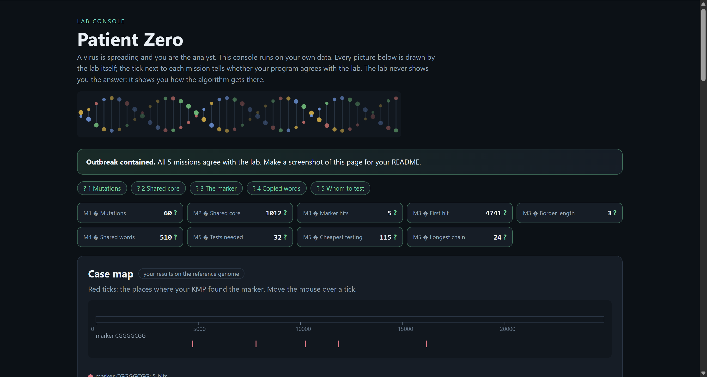

# Assignment 4. Patient Zero

Student ID: 250300
Name: Nariman Serikkali
Group: SE-2536

This file is the report. Fill it in as you go. How to start: `START_HERE.md`. The task: `docs/Assignment4.pdf`.

## Program output

The 9 lines your program prints on your data (`java -cp out Main`):

    Mutations: 60
    Shared core: 1012
    Marker hits: 5
    First hit: 4741
    Border length: 3
    Shared words: 510
    Tests needed: 32
    Cheapest testing: 115
    Longest chain: 24

My outbreak report (a screenshot of `output/outbreak.html`):

## Questions

Answer in your own words, two or three sentences each.

Mission 1. What does the cell d[i][j] of your table mean, and how is it computed from other cells?
d[i][j] is the minimum number of changes needed to turn the first i letters of A into the first j letters of B. I look at the last letters. If they are the same, I copy d[i-1][j-1]. If they are different, I take the smallest of three options plus 1: replace (d[i-1][j-1]), delete (d[i-1][j]) or insert (d[i][j-1]).

Mission 2. How is the longest common subsequence different from the longest common substring? My Shared core is bigger than the number of letters that are the same at the same place: why?
A substring is one solid piece without gaps, but in a subsequence I can skip letters, only the order must stay the same. My Shared core is bigger because when a letter is inserted or deleted, the rest of the strain shifts, so the letters are no longer at the same place, but they are still in the same order and still count.

Mission 3. What does the prefix function tell you, and why does the pointer in the text never go back in KMP? What is the Border length of my marker and what does it mean?
The prefix function pi[i] tells how long the longest start of the marker is that is also the end of its first i+1 letters. When there is a mismatch, KMP does not move back in the text. It only moves the pointer in the marker to position pi[k-1], because the letters we already matched are known and a part of them still fits. The Border length of my marker CGGGGCGG is 3: it starts with CGG and ends with CGG. So after one full match, the next match can overlap the previous one by 3 letters.

Mission 4. Why must you compare the letters after the hashes are equal? What happens to the cost of Rabin-Karp if many windows have the same hash?
Two different words can have the same hash, so equal hashes only mean "maybe the same", and I check the letters to be sure. If many windows have the same hash, I must check many candidates for each window, and the time grows from about O(n) towards O(n·m·k), because one window of A may be compared with every window of B that has the same hash.

Mission 5. What are the two states of a person in your DP, and how do you get the answer for a person from its children? Why does a greedy "test the person with most links first" not always give the cheapest answer?
Every person has two values: in[v], the cheapest cost of the subtree when v is tested, and out[v], when v is not tested. If v is tested, then in[v] = cost[v] plus, for every child u, the smaller of in[u] and out[u]. If v is not tested, then out[v] is the sum of in[u] over the children, because every child must be tested to cover the link with v. Greedy can fail because the person with the most links can be very expensive, while several cheaper people could cover the same links with a smaller total cost.

## AI use
I used Claude (Anthropic) to explain the ideas of the algorithms (edit distance, LCS, KMP, Rabin-Karp, DP on a tree), to review my code, and to help with git and the structure of the README. I read and understood every line of the code that I submitted.

## Timing (Mission 7)

Milliseconds, average of 3 runs, from `java -cp out Bench`.

| test | size | time                  |
|---|---|-----------------------|
| naive search | 20 000 / 40 000 / 80 000 | 654.1 / 273.8 / 486.0 |
| KMP | 20 000 / 40 000 / 80 000 | 7.3 / 10.2 / 8.8 |
| edit distance | 500 / 1000 / 2000 / 4000 | 18.8 / 44.9 / 323.4 / 1225.7 |

What do the numbers say about how the time grows? When you double the size, by how much does each time grow? Two or three sentences.
KMP stays at about 7-10 ms when the text grows from 20 000 to 80 000, so its time is almost linear and does not depend much on the length of the text. The naive search is much slower (hundreds of ms) and its numbers jump between runs, but it is far above KMP. Edit distance grows about 4 times when the length is doubled (for example from 2000 to 4000: 323 ms to 1226 ms), which fits the quadratic O(n·m) table.
## Complexity

n is the length of the text (or of a strain), m the length of the pattern, k the length of the window, v the number of people. Fill in every algorithm you wrote.

| algorithm | time | space | assumptions |
|---|---|--|-------------|
| Edit distance | O(n·m) | O(n·m) | full table (n+1)×(m+1)            |
| LCS | O(n·m) | O(n·m) | full table (n+1)×(m+1)            |
| Prefix function and KMP | O(n + m) | O(m) | the text pointer never goes back            |
| Rabin-Karp (shared words) | O(n + m) on average, O(n·m·k) in the worst case | O(m) | k = 12, worst case when many hashes collide            |
| Tree DP | O(v) | O(v) | one pass over the tree, no recursion            |

## Before you submit

- The four files in `data` and the screenshot `output/outbreak.png` are in the repository.
- `java tools/Check.java` shows all examples right.
- This README is filled in, the program output and the section AI use included.
- The work is pushed to main (at least one commit per mission) and the repository is public.
- The link is attached in Moodle.
